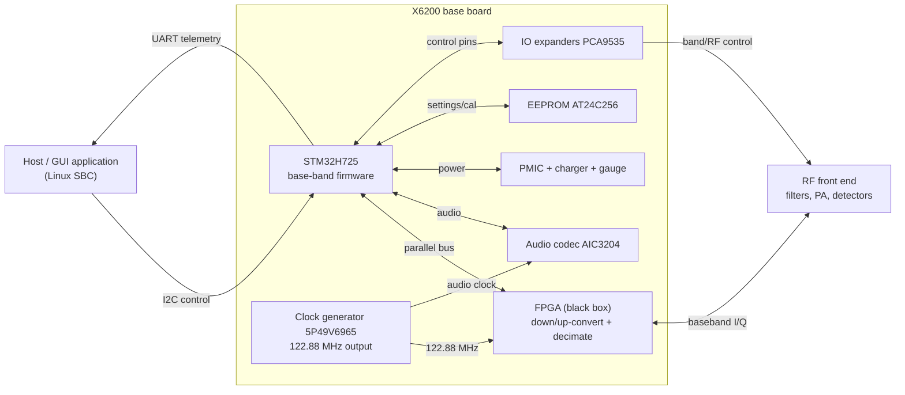

# Hardware overview

This document gives the hardware context needed to follow the rest of the
firmware documentation: the board's main blocks, how they are clocked, and how
the radio-frequency signal travels through them. It is not a schematic and does
not describe register-level details.

## Block diagram

## Main components

| Block | Part | Role |
|---|---|---|
| Microcontroller | STM32H725 | Runs the application firmware in this repository |
| FPGA | board FPGA | RF up/down-conversion and sample-rate decimation (see below) |
| Clock generator | Renesas 5P49V6965 | Single 122.88 MHz reference for the RF sampling domain and the audio clock |
| Audio codec | AIC3204 | Microphone/line-in capture and speaker/headphone output |
| Power management | AXP223 PMIC | Board power rails |
| Charger | bq24725 | Li-ion charging |
| Fuel gauge | MAX172xx | Battery voltage, current, state-of-charge and pack temperature |
| IO expanders | PCA9535 | Band filters, RF switches and other board control lines |
| EEPROM | AT24C256 | Per-unit settings and calibration data |
| RF front end | — | Band filters, PA, forward/reflected detectors, ATU relay network |

## FPGA role

The FPGA sits between the microcontroller and the RF front end and is treated as
a black box by the firmware:

- **RX**: the FPGA takes the fast ADC stream, down-converts the selected signal
  to baseband and decimates it. The firmware receives complex I/Q samples,
  one set per audio tick, at a rate selected by the requested decimation.
- **TX**: the firmware hands complex baseband I/Q to the FPGA, which up-converts
  and drives the DAC into the transmit path.

The microcontroller configures the FPGA over a bit-banged parallel bus: tuning
words for the receive and transmit branches, the sample-rate (decimation)
selection, the transmit/receive branch, and per-unit calibration bytes read from
the board EEPROM. Reference FPGA sources exist in the repository under `wolf/`,
but the firmware documentation treats the FPGA purely by its interface.

## Clocking

A single clock source drives the whole radio:

- **122.88 MHz** from the clock generator feeds the FPGA. The FPGA's local
  oscillator, the band/tuning selection and the decimation ratios are all derived
  from this value, so the effective sample rates seen by the firmware are always
  a fixed subdivision of it.
- **48 kHz** is the shared audio rate: it clocks the audio codec, drives the
  FPGA bus tick and runs the receive/transmit audio processing.

Because the RF decimation and the audio domain come from the same clock source,
the receive and transmit sample rates stay in step with the audio blocks.

## RF signal chain

At a high level, on receive the antenna signal passes the band filters and enters
the ADC path feeding the FPGA. On transmit, baseband I/Q leaves the FPGA, is
up-converted and amplified by the PA, passes the band filters and reaches the
antenna. In the transmit path the signal may also pass the automatic antenna
tuner (ATU) relay network, which the firmware drives to match the antenna.

Forward and reflected power are measured by detectors after the PA and read by
the microcontroller's ADC; these feed the transmit level control and the VSWR
protection.

## Board signals

The firmware also uses a set of discrete board signals: the power button, the
external microphone PTT and detection, the CW host key input, status LEDs, the
transmit/receive relay and RX-ADC routing, the PA bias enable, and the ACC TRX
line for an external amplifier. All of these are abstracted by the platform layer
so the application code never touches board pins directly.
