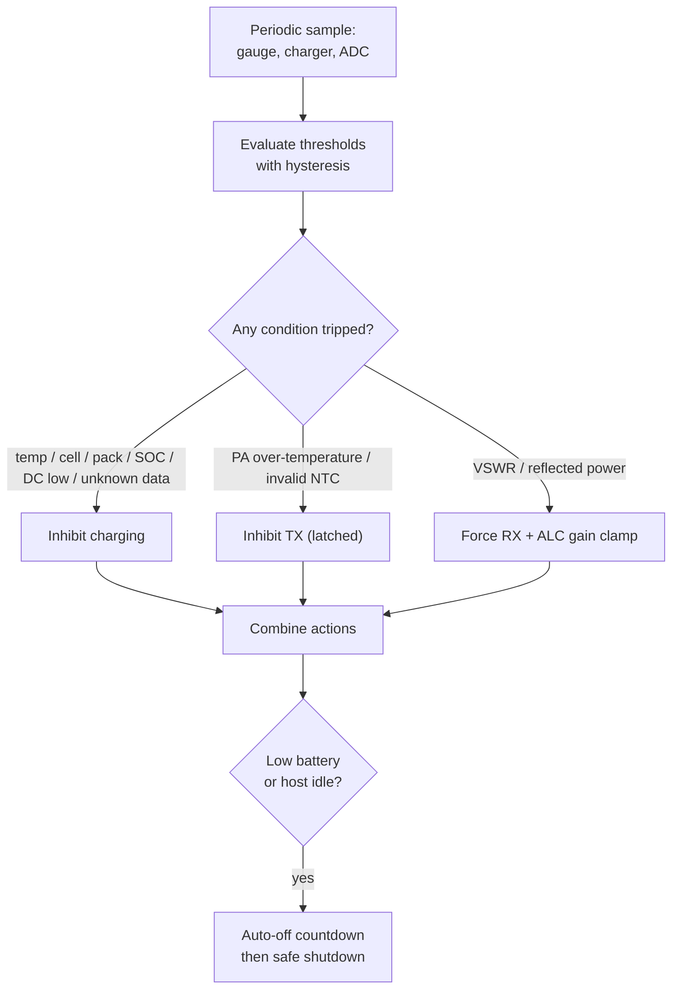

# Protections and power management

The firmware continuously monitors the battery, the PA temperature, the supply
voltages and the transmit reflected power, and reacts to keep the radio and the
PA within safe limits. This document describes the conditions, the actions taken
and how a condition clears.

## How protections run

Sensors are read in a periodic housekeeping tick over the I2C buses and the
microcontroller ADC. When sensor data cannot be read, it is treated as unsafe
rather than assumed good, so a failed sensor fails safe. Any trip inhibits
charging, and the relevant trips also cut transmission. Thresholds and their
hysteresis (release) values are configured in the platform board configuration
file; this document describes what they control rather than the numbers.

## Battery temperature

The pack temperature is watched for high, low and cold extremes. High and low
temperatures inhibit charging; the cold condition also inhibits charging, since
charging a cold Li-ion pack is unsafe. Each condition clears only when the
temperature returns past its release point.

## Cell and pack voltage, state of charge

- **Per-cell over-voltage** — stops charging when a cell is full; releases below
  its hysteresis point.
- **Per-cell under-voltage** — a weak cell; charging drops to a low precharge
  current until the cell recovers.
- **Pack low voltage** — the whole pack is low; raises the low-battery warning.
- **Low state of charge** — raises the low-battery warning.

The low-battery warning arms the auto-off countdown (below). The voltage and SOC
conditions cannot be fully trusted when the fuel gauge is absent or unreadable,
in which case the data is reported as invalid and charging is inhibited.

## PA temperature

The PA has its own thermistor. Over-temperature inhibits transmission with a
latch: it is not cleared by a momentary temperature dip but only by a valid
reading at or below the release threshold. An invalid thermistor reading also
inhibits transmission. This protection is independent of the ALC.

## VSWR and reflected power

During transmission the firmware computes the forward and reflected power and
the standing-wave ratio from the PA detectors:

- A **VSWR trip** forces the radio back to receive (a one-shot event). A
  still-held PTT source cannot re-enter transmit until it is released.
- The **ALC SWR clamp** winds the gain down for a mismatched load.
- The **fast clamp** is an absolute ceiling on the applied gain.

While the automatic tuner is tuning or the host is scanning SWR, the VSWR trip
and the SWR clamp are disabled so they do not interfere with the measurement;
the temperature and PA protections stay active.

## External DC input

The firmware detects whether an external DC adapter is present and whether its
voltage is high enough. A too-low external input inhibits charging. The charger
itself also reports adapter presence.

## Charging policy

Charging is enabled by default and can be turned off by the user (a stored
preference). The user preference can only remove the firmware's permission; it
never overrides a protection trip. The charger uses a low precharge current for a
weak cell and tapers the current as the maximum cell voltage approaches full. It
also has its own SMBus watchdog, so charging auto-suspends if the firmware stops
refreshing it.

## Portable power and shutdown

- **Power button** — a long press requests power-off.
- **Auto-off** — if no host frame is received for a while, or a low-battery
  warning is active, a countdown starts and the radio powers itself off if the
  condition persists.
- **Safe shutdown sequence** — before cutting power, the firmware inhibits
  charging, silences the PA, saves the charger preference, puts the battery gauge
  to sleep, and finally drops the power holds and resets.

The power-off sequence runs from the periodic protection tick rather than the
main loop, so it stays reachable even if the main loop is busy.

## Summary

| Condition | Action | Clears when |
|---|---|---|
| Battery too hot / too cold / too low | Inhibit charging | Temperature returns past release |
| Per-cell over-voltage | Inhibit charging | Cell falls below release |
| Per-cell / pack under-voltage | Precharge, warn | Voltage recovers |
| Low state of charge | Warn, arm auto-off | SOC recovers |
| PA over-temperature | Inhibit TX (latched) | Valid reading at/below release |
| Invalid PA thermistor | Inhibit TX (latched) | Valid reading returns |
| High VSWR during TX | Force RX (one-shot) | Source released; ALC clamp recovers |
| External DC too low | Inhibit charging | Input voltage recovers |
| Sensor data unknown | Inhibit charging | Valid reading returns |
| Power button long press | Power-off | — |
| Host idle / low battery | Auto-off countdown | Host frame or battery recovers |
