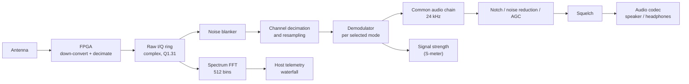

# Receive path

This document describes how a received signal travels from the antenna to the
speaker, which demodulations are supported, and what signal-processing
enhancements run on the way.

## Signal flow

The FPGA streams complex I/Q samples to the firmware, one set per 48 kHz audio
tick. The number of samples per tick is selected by a decimation setting
(`fftdec` 0..3), giving a baseband rate of 384, 192, 96 or 48 kHz. The firmware
reads the samples from a ring buffer, decimates and resamples them to the rate
the selected mode needs, demodulates, and finally produces a 48 kHz audio block
for the codec.

## Supported demodulations

| Mode | Description |
|---|---|
| LSB, LSB-D | Lower sideband. The `-D` (digital) variant is used for data and host-audio applications |
| USB, USB-D | Upper sideband. Same `-D` variant as above |
| CW, CWR | Morse reception; CWR is the reverse-sideband variant |
| AM, SAM | Amplitude modulation, and synchronous AM |
| NFM | Narrowband FM (voice); the host RX window width selects one of three bandwidth/deviation profiles: 15 / 10 / 7 kHz → 5 / 2.5 / 1 kHz |
| WFM | Wideband FM (broadcast), receive only |

All sideband modes (`LSB`/`USB`, including the `-D` variants) share the same
demodulator and channel filtering. The `-D` suffix matters mainly on transmit,
where it selects the host audio input for data modes.

NFM keeps three channel-filter profiles; the host's RX window width selects the
profile (15 / 10 / 7 kHz, i.e. 5 / 2.5 / 1 kHz deviation). The selected profile
also sets the transmit deviation, so there is no separate TX bandwidth setting.
The 7 kHz profile is flat in both directions (pre- and de-emphasis disabled).
Its S-meter and noise estimate use the selected band, while the squelch uses a
dedicated out-of-band noise metric from the discriminator.

WFM uses a higher baseband rate and imposes a constraint on the decimation
setting; the firmware refuses a mode/rate combination that the FPGA source rate
cannot feed, and in normal operation the host supplies a valid pair.

## Audio processing chain

After demodulation, the audio passes through a set of shared blocks. FM modes
bypass the AGC and the spectral enhancement blocks, which are intended for
voice/CW signals:

- **Noise blanker** — suppresses impulse noise (for example ignition or
  switching noise) on the raw I/Q before channel decimation. Off by default;
  width and threshold follow the host settings.
- **Notch filter** — removes a narrow interfering tone; can be set manually or
  track automatically.
- **Spectral noise reduction** — reduces steady background noise on the audio.
  Off by default; the threshold comes from the host.
- **AGC** — automatic gain control that holds the audio level steady for the
  voice and CW modes.
- **Squelch** — mutes the audio when no signal is present, with hysteresis and a
  smooth gain ramp so mute/unmute does not click.

## Signal strength

The signal-strength value reported to the host depends on the mode group:
sideband and CW modes read the in-band power from their demodulator, while
AM/SAM and FM modes use the in-band power from the spectrum. The value is held
while transmitting.

## Spectrum and waterfall

A separate spectrum path runs continuously alongside the audio chain: the
firmware computes a 512-bin FFT of the received I/Q and streams it to the host
as part of the telemetry packet, producing the waterfall display. For CW
reception the spectrum can be zoomed (decimated) so a narrow span is shown in
more detail.
