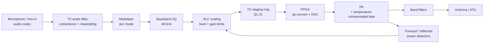

# Transmit path

This document describes how microphone or host audio becomes a radio-frequency
signal: the supported transmit modes, the automatic level control, the PA chain
and the special tune carriers used for tuning and SWR scanning.

## Signal flow

The modulator produces complex baseband I/Q at 48 kHz. The automatic level
control scales it, the result is queued in the FPGA's transmit staging ring, and
the FPGA up-converts and drives the DAC. Forward and reflected power are
measured after the PA and fed back into the level control and the protections.

## Supported transmit modes

| Mode | Description |
|---|---|
| LSB, USB | Lower/upper sideband voice |
| LSB-D, USB-D | Sideband data modes; take the host audio input |
| CW, CWR | Morse transmission from the internal keyer |
| AM, SAM | Amplitude modulation |
| NFM | Narrowband FM voice. Deviation follows the selected RX bandwidth profile (15 / 10 / 7 kHz → 5 / 2.5 / 1 kHz); the 7 kHz profile is flat, without pre-emphasis |

WFM is receive-only. A transmit request for a mode without a modulator is
refused. NFM has no separate transmit bandwidth setting: its deviation follows
the bandwidth profile selected for receive.

## Audio input routing

The transmit audio source depends on the active mode and the PTT source:

- Voice and FM modes use the microphone as the primary input.
- Digital (`-D`) sideband modes and host-keyed transmissions use the host/line-in
  audio input.
- CW and CWR ignore the host audio input entirely and use the internal keyer
  (paddle or host key).

The routing is fixed when the transmission starts and is not re-arranged while
transmitting.

## Audio compression

Before modulation, the transmit audio passes through an audio compressor that
raises the average loudness of voice for a given peak level. Its threshold can be
adjusted, and it can be enabled or disabled, from the calibration console (see
[calibration.md](calibration.md)).

## Automatic level control (ALC)

The ALC keeps the transmit power at the operator's setpoint and protects the PA.
It works in a normalized domain and applies its result at the boundary to the
FPGA as a gain factor. Its layers are all *absolute limits* — they only ever
attenuate, never boost, and they never stack on top of each other:

- **Per-band level** — a calibrated offset per frequency band makes the
  input-to-output transfer the same on every band, so the learned correction
  does not have to change when the operator changes band.
- **Slow trim** — corrects the residual transfer error toward the measured
  average output. It is independent of the setpoint and the input level.
- **Fast peak limiter** — limits a single block whose peak exceeds the setpoint
  by a fixed margin.
- **Fast clamp** — an absolute ceiling on the applied gain, as a hard protection.
- **SWR clamp** — winds the gain down when the reflected power is high (a
  mismatched antenna).
- **External ALC back-off** — a command from an external amplifier over the
  EXT ALC line that can only reduce power. It is tracked even outside transmit.

The learned transfer and the gain state are kept across key-down and across a
band change, so a transmission starts at the configured level instead of
open-loop.

## PA bias and temperature compensation

The PA has two bias channels (a drive stage and a final stage), set from
calibration. On top of that, an open-loop temperature compensation lowers the
bias as the PA heats up, on both channels. This is a thermal correction, not part
of the ALC, and it never raises the bias above the calibrated value.

## Tune carriers

For the automatic antenna tuner and for SWR scanning, the transmit branch can
generate a steady, unmodulated carrier with a smooth ramp instead of the
modulator:

- **ATU tune** — the tuner keys the carrier for each measurement and blanks it
  while its relays switch, so the antenna network is never switched under RF.
- **SWR scan** — the host sweeps the frequency while the firmware holds a low
  unmodulated carrier, letting the host GUI read the SWR across the band.

During tuning, the SWR trip and the SWR gain clamp are disabled so they do not
fight the tuner, while the temperature and PA protections remain active.

## Frequency limits and band filters

Transmission is refused above the maximum transmit frequency (54 MHz). Below it,
the firmware switches the appropriate band filters and applies the band-specific
level offset. The receive and transmit signal paths use different FPGA tuning
branches, and the firmware folds in any split, RIT or XIT offset before setting
the transmit frequency.

## PTT sources

Several independent sources can request transmission: the microphone PTT, a
foot or hand switch, a CAT command from the host, the CW key, a calibration
request, and the tuner/scan carriers. An arbiter combines them on a
"first source wins" basis and holds the transmission until every source is
released. After a protection forces the radio back to receive, a still-held
source cannot immediately re-enter transmit until it is released.
